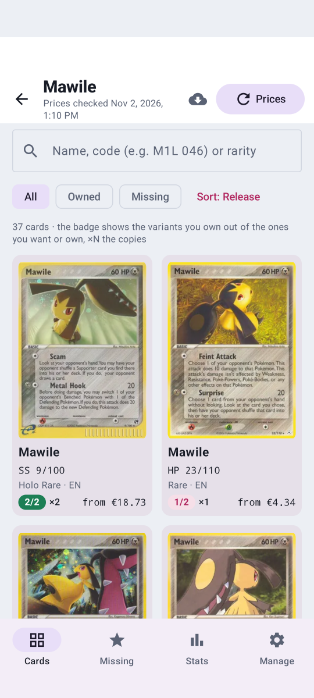
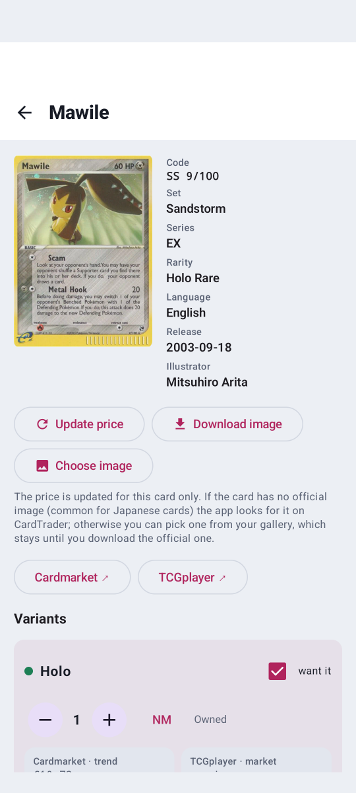
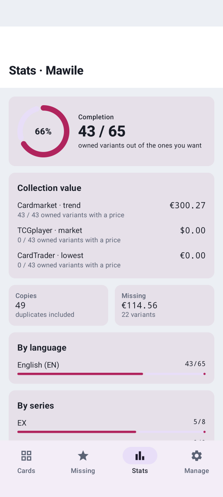
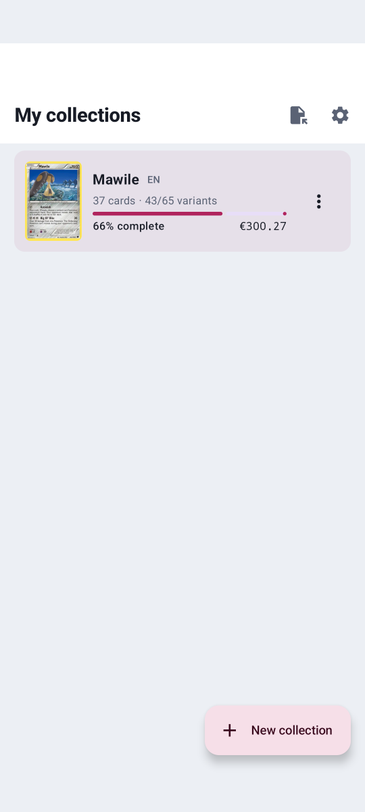
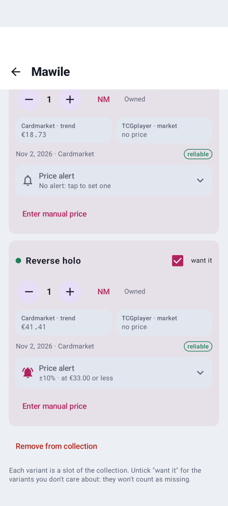
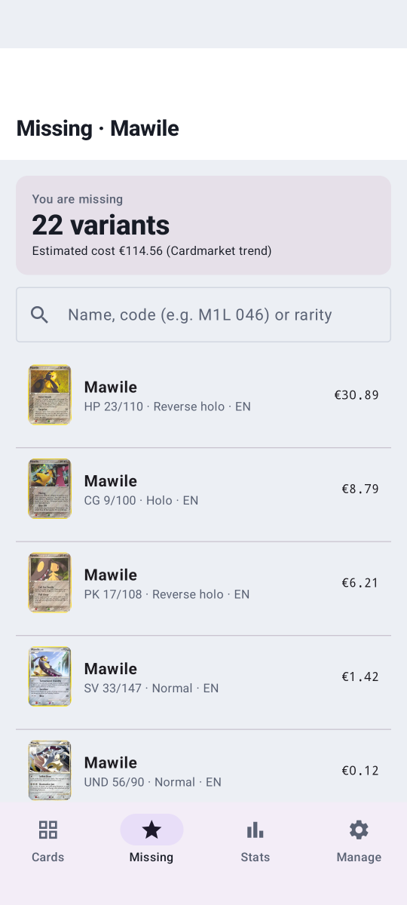
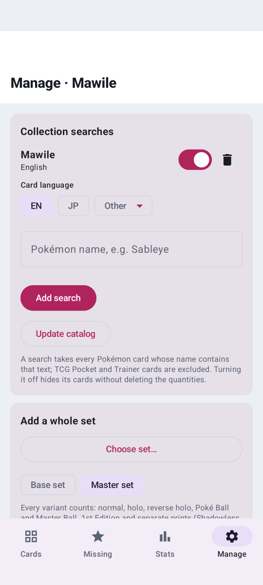
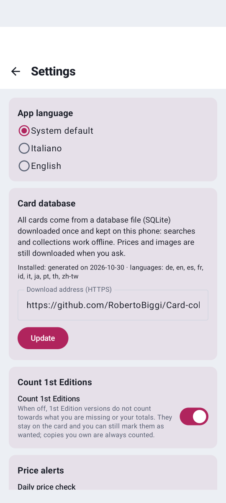

# Card Collection

App Android per tenere traccia della tua collezione di carte Pokémon: quali carte hai, in quale variante e condizione, quali ti mancano e quanto valgono.

Le carte e le immagini restano sul telefono, quindi l'app funziona anche senza rete. La rete serve solo per scaricare immagini e prezzi, e solo quando lo chiedi tu (o per gli avvisi di prezzo, se li attivi).

L'app è in italiano e in inglese.

<p align="center">
  
  &nbsp;
  
  &nbsp;
  
</p>

## In breve

- **Più collezioni**: per Pokémon (es. tutti i Mawile), per set (set base o master set) o con carte scelte una a una.
- **Ogni variante conta**: normale, holo, reverse holo, 1st Edition, Poké Ball, Master Ball… Per ognuna segni copie e condizione.
- **Prezzi Cardmarket** in euro, più quelli di CardTrader se hai un account, e prezzi inseriti a mano.
- **Avvisi di prezzo**: una notifica quando una carta sale o scende, o quando arriva al prezzo che vuoi.
- **Mancanti e statistiche**: cosa ti manca, quanto costa completare e quanto vale quello che hai.
- **Backup in un file**: esporti una collezione, anche con le immagini, e la importi su un altro telefono.
- **Carte in tante lingue**: inglese, italiano, francese, tedesco, spagnolo, portoghese, giapponese e altre.

## Installazione

L'app non è sul Play Store: si installa dall'APK pubblicato nelle [Release](../../releases) di questo repository. Serve Android 8.0 o successivo.

- **Con aggiornamenti automatici (consigliato):**
  1. Installa [Obtainium](https://github.com/ImranR98/Obtainium).
  2. Aggiungi l'indirizzo di questo repository: Obtainium ti avvisa delle nuove versioni e le installa.
  3. Finché il repository è privato, serve un token GitHub in sola lettura, da inserire nelle impostazioni della sorgente in Obtainium.
- **A mano:**
  1. Scarica `card-collection-<versione>.apk` dall'ultima Release.
  2. Aprilo sul telefono, consentendo l'installazione da origini sconosciute.

Il database delle carte è già incluso nell'app: puoi cercare e aggiungere carte subito, anche offline.

## Primi passi

1. Tocca **Nuova collezione**, dagli un nome e scrivi i Pokémon che vuoi seguire (es. `Mawile`, oppure `Moltres, Zapdos`).
2. L'app trova tutte le carte di quei Pokémon e ne scarica le immagini.
3. Tocca **Prezzi** per scaricare i prezzi aggiornati.
4. Apri una carta e segna le copie che hai con **+** e **−**.

Da qui in poi tutto resta sul telefono. Riapri **Prezzi** quando vuoi aggiornare.

## Guida alle funzioni

### Le tue collezioni



All'avvio vedi tutte le collezioni. Ognuna ha la copertina, la percentuale di completamento e il valore. Toccandone una la apri.

Dal menu **⋮** di una collezione puoi:
- rinominarla e sceglierne le lingue;
- esportarla in un file JSON;
- eliminarla.

L'icona in alto **importa** una collezione da un file. Ogni collezione ha le sue carte e le sue quantità. Immagini e prezzi sono condivisi, quindi non si scaricano due volte.

<br clear="right">

### Le carte


La griglia mostra tutte le carte della collezione con immagine, codice stampato (es. `POR 032/088`, come in basso a sinistra sulla carta vera) e prezzo.

- Il badge **`1/2`** indica quante varianti hai su quante ne vuoi; **`×3`** il numero totale di copie.
- **Cerca** per nome, codice (es. `M1L 046`) o rarità. Il nome si può scrivere anche in un'altra lingua: "Omastar" trova anche オムスター. Accenti e maiuscole non contano.
- **Filtra** tra tutte, possedute e mancanti, e per lingua.
- **Ordina** per uscita, prezzo, codice o nome.
- I pulsanti in alto **aggiornano il catalogo** (nuove carte e immagini) e **i prezzi**. Il lavoro continua anche se esci dall'app, con una notifica di avanzamento.

<br clear="right">

### Il dettaglio di una carta


Toccando una carta vedi l'immagine grande e i dati: set, serie, rarità, lingua, data di uscita e illustratore. Più in basso trovi le **varianti**. Per ognuna puoi:

- segnare le **copie** che hai con **+** e **−**;
- scegliere la **condizione**: NM, LP, MP, HP o DMG;
- togliere **"la voglio"** se quella variante non ti interessa: non conterà tra le mancanti;
- vedere i **prezzi** per fonte, con la data e l'andamento;
- inserire un **prezzo manuale**, se non ne trovi uno.

In cima alla scheda ci sono tre azioni:
- **Aggiorna il prezzo** solo di quella carta.
- **Riscarica l'immagine**.
- **Scegli un'immagine dalla galleria**: è utile per le carte giapponesi senza foto ufficiale. L'immagine scelta viene ridimensionata e salvata senza metadati.

I link aprono la carta su Cardmarket e CardTrader.

<br clear="right">

### Avvisi di prezzo



Sotto i prezzi di ogni variante c'è il pannello **Avviso prezzo**. Lì puoi chiedere all'app di avvisarti:

- **quando il prezzo sale o scende** di una certa percentuale: la scegli tu per ogni carta, da 1% a 50%;
- **quando il prezzo arriva a una cifra** che decidi tu, es. "avvisami quando arriva a 20 €". L'avviso parte quando il prezzo più basso in euro scende entro il 5% da quella cifra, o sotto.

Gli avvisi vanno attivati una volta in **Impostazioni → Avvisi di prezzo** (sono spenti di default). Ogni mattina verso le 4:30, dopo l'aggiornamento del listino Cardmarket, l'app controlla solo le carte con un avviso. Se qualcosa è cambiato ti manda una notifica, e toccandola si apre la carta.

<br clear="right">

### Mancanti



Elenca tutte le varianti che vuoi e non hai ancora, con il **costo stimato** per completare la collezione (prezzi trend di Cardmarket). Indica anche quante carte non hanno ancora un prezzo.

Le varianti segnate come "non la voglio" non compaiono e non contano nel completamento.

<br clear="right">

### Statistiche


- **Completamento**: varianti possedute su quelle che vuoi.
- **Copie**: il totale, doppioni compresi.
- **Valore della collezione**: euro e dollari restano separati, senza conversioni.
- **Avanzamento** per lingua e per serie.
- Storico degli **ultimi aggiornamenti dei prezzi**.

<br clear="right">

### Gestione della collezione



Qui decidi quali carte fanno parte della collezione.

- **Ricerche**: ogni ricerca prende tutte le carte di un Pokémon in una lingua (es. `Mawile` in inglese, `クチート` in giapponese). Le carte di TCG Pocket e gli Allenatori sono esclusi. Puoi disattivare una ricerca senza perdere le quantità.
- **Set interi**: scegli un set, anche vintage, e collezionalo in uno di due modi:
  - **set base**: una carta per numero;
  - **master set**: ogni variante, cioè normale, holo, reverse, Poké Ball e Master Ball.
- **Carte singole**: per promo o carte che nessuna ricerca trova. Puoi cercare per nome o per il codice stampato sulla carta:
  - con sigla e numero: `M3 117/080`, `DX 107`;
  - solo con il numero: `117/080`;
  - con l'id: `M3-117`, `ex8-107`.
- **Carte tolte**: le carte rimosse dalla collezione restano qui e puoi rimetterle quando vuoi.
- **Esporta**: salva la collezione in un file JSON, con o senza immagini.

<br clear="right">

### Impostazioni



- **Lingua dell'app**: italiano, inglese o quella del telefono.
- **Database delle carte**: mostra la versione installata e permette di aggiornarla.
- **Fonti prezzi**: scegli quali prezzi mostrare. Quelli nascosti non compaiono nelle schede né nei totali.
- **CardTrader** (facoltativo): incolla il tuo token API (CardTrader → Impostazioni → API). Da quel momento ogni variante ha anche il prezzo più basso su CardTrader, filtrato per variante, lingua e condizione: conta quella che hai impostato, o una migliore. Le carte gradate sono escluse.
- **Avvisi di prezzo**: accendi il controllo giornaliero e scegli la soglia proposta ai nuovi avvisi.
- **1st Edition**: decidi se le 1st Edition contano tra le mancanti e nei totali.

<br clear="right">

### Backup e cambio di telefono

Ogni collezione si esporta in un unico file JSON. Il file contiene carte, quantità, condizioni e prezzi; le immagini puoi scegliere di non includerle, oppure di includerle piccole o anche grandi.

Dall'elenco delle collezioni importi il file su un altro telefono, anche senza rete: l'import crea sempre una nuova collezione, senza toccare quelle che hai. Sono accettati anche i backup della prima versione dell'app.

## Privacy e sicurezza

- **Nessun account e nessun server**: i dati stanno solo sul tuo telefono.
- **Prezzi Cardmarket dal listino ufficiale**: l'app scarica il listino prezzi pubblico che Cardmarket aggiorna ogni notte e non apre mai le pagine di cardmarket.com, quindi niente blocchi anti-bot.
- **Pochi indirizzi contattati**: le immagini di TCGdex, il listino Cardmarket e, se lo attivi, CardTrader. Nessun altro.
- **Token CardTrader cifrato** con una chiave del Keystore di Android, che non lascia il telefono. Il token non finisce nel backup di Android: dopo un ripristino o su un telefono nuovo va reinserito.

## Domande frequenti

**Una carta non ha l'immagine.**
Apri la carta e tocca "Scarica immagine": l'app la cerca su TCGdex e, se lì manca, su CardTrader. Se non la trova da nessuna parte, puoi sceglierne una dalla galleria.

**Una carta non ha prezzo.**
Non tutte le carte sono vendute su Cardmarket (succede spesso con le promo giapponesi). Puoi attivare CardTrader o inserire un prezzo manuale dal dettaglio della carta.

**Non ricevo gli avvisi.**
Controlla tre cose:
- in Impostazioni il controllo giornaliero deve essere acceso;
- le notifiche dell'app devono essere permesse nelle impostazioni di Android;
- la carta deve avere un avviso salvato: nel pannello compare la campanella piena.

**Passo da una build di prova alla release (o viceversa).**
Le build di prova (artifact `card-collection-apk` nelle Actions) sono firmate con una chiave diversa dalla release, quindi Android non le aggiorna l'una sull'altra. Esporta prima le collezioni, disinstalla, installa l'altra versione e reimporta. Vale lo stesso per chi arriva dalle versioni fino alla 0.5.0.

---

## Per sviluppatori

| Modulo | Contenuto |
|---|---|
| `core/` | Kotlin/JVM puro, senza testi per l'utente: listino Cardmarket, client CardTrader, mappatura dei prezzi per variante, catena di fonti con rate limiter e circuit breaker, regole degli avvisi, validatori, formato JSON delle collezioni, statistiche. |
| `app/` | Android: database delle carte (SQLite incluso nell'APK), Room, WorkManager, archivio immagini, UI Compose, import/export con lo Storage Access Framework. Testi in `res/values` (inglese) e `res/values-it` (italiano). |
| `docs/` | Architettura (`ARCHITECTURE.md`) e screenshot del README. |

```bash
./gradlew -PcoreOnly :core:test           # test della logica (serve solo la JDK)
./gradlew :app:testDebugUnitTest          # test dell'app (serve l'Android SDK)
./gradlew :app:assembleDebug              # APK di prova
```

- **Database delle carte**: `cards.sqlite` è generato da un repository separato e pubblicato nella release `catalog`. La CI lo scarica e lo include nell'APK.
- **Release**: a ogni push su `main` la CI pubblica una Release con l'APK firmato con la chiave di release (versione `0.6.N`, dove N cresce a ogni commit). Usa i secret `RELEASE_KEYSTORE_BASE64`, `RELEASE_KEYSTORE_PASSWORD`, `RELEASE_KEY_ALIAS` e `RELEASE_KEY_PASSWORD`, e controlla l'impronta del certificato. La chiave non va mai messa nel repository: se va persa, l'app installata non si può più aggiornare.
- **Screenshot del README**: il workflow `README screenshots` (`.github/workflows/screenshots.yml`) avvia un emulatore e fa girare il test `ReadmeScreenshots`. Il test crea una collezione Mawile con dati veri e salva le schermate in `docs/screenshots`. Per rifarli basta lanciarlo a mano dalle Actions.

## Licenza

Il codice è distribuito con licenza [MIT](LICENSE). I dati di terze parti inclusi o scaricati (TCGdex, PokeAPI, immagini delle carte) restano soggetti alle rispettive licenze e marchi.

## Crediti

- **Catalogo e immagini**: [TCGdex](https://tcgdex.dev).
- **Prezzi**: [Cardmarket](https://www.cardmarket.com), dal listino pubblico, e [CardTrader](https://www.cardtrader.com).
- **Nomi dei Pokémon in più lingue**: [PokeAPI](https://pokeapi.co), licenza BSD-3-Clause.

Pokémon e i nomi dei Pokémon sono marchi di Nintendo, Creatures e GAME FREAK; questa app non è affiliata né approvata da The Pokémon Company.
