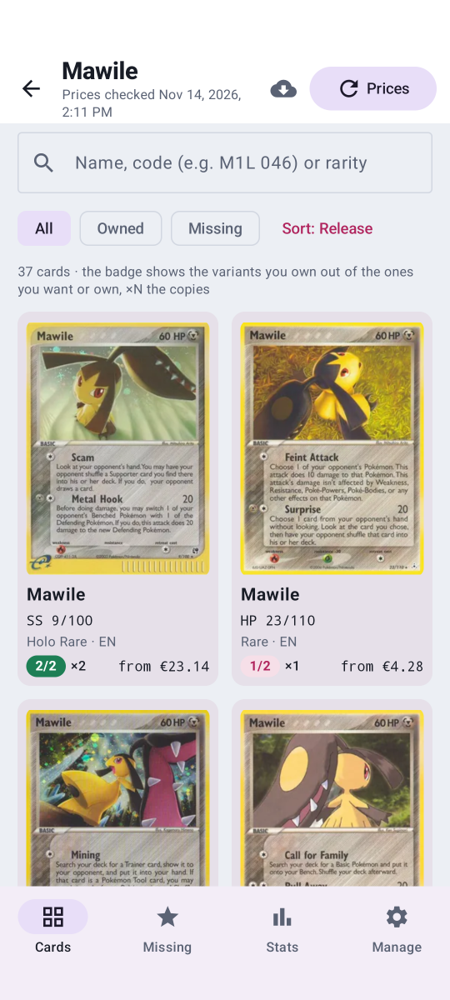

# Card Collection

An offline-first Android app to track your Pokémon card collection: every variant you own, what you are still missing, and what it is worth.

<p align="center">
  
  
  
</p>

<p align="center">
  
  &nbsp;
  
  &nbsp;
  
</p>

## Features

- Collections by Pokémon, by set (base or master set) or hand-picked cards, in many card languages.
- Copies and condition tracked for every variant (normal, holo, reverse, 1st Edition, Poké Ball…).
- Cardmarket prices, optional CardTrader prices, and price alerts by notification.
- Missing cards with cost to complete, collection value and progress statistics.
- Works offline. Backups go to a JSON file. English and Italian UI.

**How to use it:** see the [user guide](docs/USER_GUIDE.md).

## Install

Requires Android 8.0 or later. Download the APK from the latest [Release](../../releases), or add this repository to [Obtainium](https://github.com/ImranR98/Obtainium) for automatic updates.

## Development

```bash
./gradlew -PcoreOnly :core:test     # logic tests (JDK only)
./gradlew :app:testDebugUnitTest    # app tests (Android SDK)
./gradlew :app:assembleDebug        # test APK
```

- `core/` is pure Kotlin. `app/` is Android: Compose, Room and WorkManager.
- Architecture notes, in Italian, are in [docs/ARCHITECTURE.md](docs/ARCHITECTURE.md).
- CI tests every push.
- Every push to `main` publishes a signed Release. Signing uses repository secrets; the key is never in the repo.
- The README screenshots come from the `README screenshots` workflow, which runs the app on an emulator with real data.

## License and credits

The code is released under the [MIT](LICENSE) license.

Data sources, each with its own license or trademarks:
- card data and images: [TCGdex](https://tcgdex.dev);
- prices: [Cardmarket](https://www.cardmarket.com) and [CardTrader](https://www.cardtrader.com);
- Pokémon names: [PokeAPI](https://pokeapi.co).

Pokémon is a trademark of Nintendo, Creatures and GAME FREAK. This app is not affiliated with The Pokémon Company.
