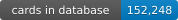
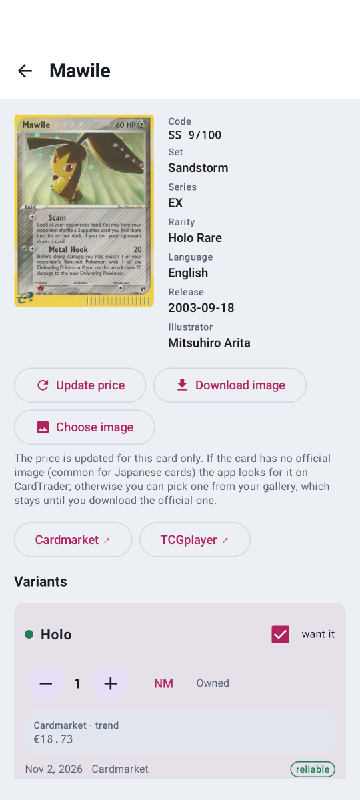
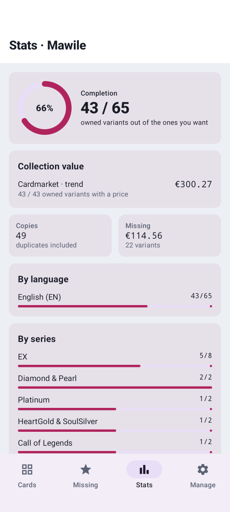

# Card Collection

An offline-first Android app to track your Pokémon card collection: every variant you own, what you are still missing, and what it is worth.

<p align="center">
  
  
  
  
</p>

<p align="center">
  
  &nbsp;
  
  &nbsp;
  
</p>

## Features

- Collections by Pokémon, by set (base or master set) or hand-picked cards, in many card languages.
- Copies and condition tracked for every variant (normal, holo, reverse, 1st Edition, Poké Ball…).
- Cardmarket prices, optional CardTrader prices, and price alerts by notification.
- Missing cards with cost to complete, collection value and progress statistics.
- Works offline. Backups go to a JSON file. English and Italian UI.

**How to use it:** see the [user guide](docs/USER_GUIDE.md).

## Install

<p>
  <a href="../../releases/latest/download/card-collection.apk"></a>
</p>

Requires Android 8.0 or later. The button above always downloads the latest version: open the file on the phone and Android installs it over the previous one, keeping your data. You can also pick the APK from the latest [Release](../../releases/latest), or add this repository to [Obtainium](https://github.com/ImranR98/Obtainium) for automatic updates. Until signed releases are set up, the latest Release is **Test build**: the APK of the last push to `main`, replaced at every update.

## Privacy

The app talks only to the card, image and price sources it needs. If this build has an [Aptabase](https://aptabase.com) key, it also sends one anonymous `app_open` event per day with the app version, Android version and language: no device identifier, nothing about your collection. It is on by default and can be turned off in **Settings → Anonymous statistics**. Maintainers set the key in `gradle.properties` (`aptabaseKey`); empty means no counter at all.

## Development

```bash
./gradlew -PcoreOnly :core:test     # logic tests (JDK only)
./gradlew :app:testDebugUnitTest    # app tests (Android SDK)
./gradlew :app:assembleDebug        # test APK
```

- `core/` is pure Kotlin. `app/` is Android: Compose, Room and WorkManager.
- CI tests every push.
- Every push to `main` publishes a signed Release when the release key is set in the repository secrets (the key is never in the repo). Without it, the APK of `main` goes to the fixed **Test build** Release (`test-build`), replaced at every push.
- The README screenshots come from the `README screenshots` workflow, which runs the app on an emulator with real data.

## License and credits

The code is released under the [MIT](LICENSE) license.

Data sources, each with its own license or trademarks:
- card data and images: [TCGdex](https://tcgdex.dev);
- extra card images, for sets TCGdex lacks (mostly Japanese ones and promos): [Pokellector](https://jp.pokellector.com), [Pokoin](https://pokoin.com) and [Pokumon](https://pokumon.com), the last one also for the old unnumbered promos;
- prices: [Cardmarket](https://www.cardmarket.com) and [CardTrader](https://www.cardtrader.com), plus a search link to [TCGplayer](https://www.tcgplayer.com) in the card detail;
- rarities, promo dates and events, used when the database is built: [Bulbapedia](https://bulbapedia.bulbagarden.net);
- Pokémon names: [PokeAPI](https://pokeapi.co);
- anonymous usage counter (optional, see above): [Aptabase](https://aptabase.com).

Pokémon is a trademark of Nintendo, Creatures and GAME FREAK. This app is not affiliated with The Pokémon Company.
