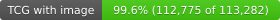
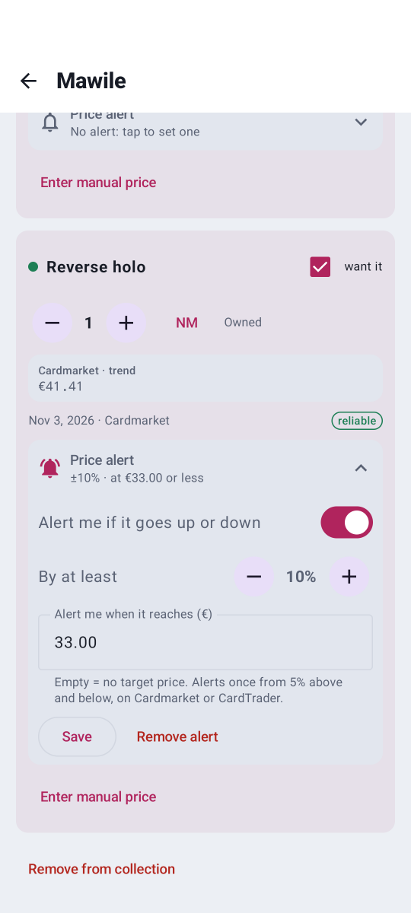
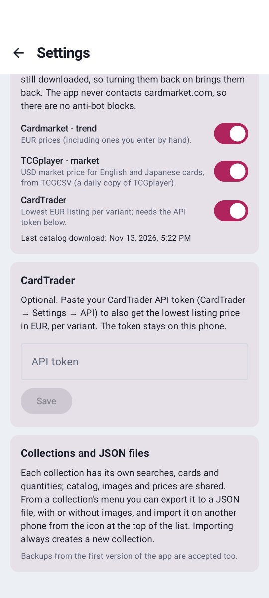

# BB PokeCollector

An offline-first Android app to track your Pokémon card collection: every variant you own, what you are still missing, and what it is worth.

  
  
  
  

<table align="center">
  <tr>
    <td align="center"> Card detail</td>
    <td align="center"> Price alert</td>
    <td align="center"> Statistics</td>
    <td align="center"> Price sources and CardTrader token</td>
  </tr>
</table>

## Features

- Collections by Pokémon, by set (base or master set) or hand-picked cards, in many card languages.
- Copies and condition tracked for every variant (normal, holo, reverse, 1st Edition, Poké Ball…).
- Cardmarket prices, TCGplayer prices (USD, English and Japanese cards), optional CardTrader prices, and price alerts by notification.
- Missing cards with cost to complete, collection value and progress statistics.
- Works offline. Backups go to a JSON file. English and Italian UI.

**How to use it:** see the [user guide](docs/USER_GUIDE.md).

## Install

  
  

Requires Android 8.0 or later. The button above always downloads the latest version: open the file on the phone and Android installs it over the previous one, keeping your data. You can also pick the APK from the latest [Release](../../releases/latest), or tap the Obtainium button to get automatic updates (it tracks the latest Release). Every update of `main` publishes a new signed Release.

## Privacy

- **No account and no server**: your collections stay on your phone.
- **Only the addresses it needs**: the app contacts only the image sources, Cardmarket's price-list file, TCGCSV (TCGplayer prices), the card database download, GitHub (to see whether a newer version of the app exists, and to download it when you tap the notification), the anonymous counter below and, if you set a token, the CardTrader API. Every other address is blocked.
- **CardTrader token**: encrypted with an Android Keystore key that never leaves the phone, and excluded from Android backups.
- **Images you choose**: re-encoded without metadata, so location and camera details are not kept.
- **Anonymous statistics**: once a day the app sends one `app_open` event to [Aptabase](https://aptabase.com) with the app version, the Android version and the language. No device identifier, nothing about your collection. It is on by default; turn it off in **Settings → Anonymous statistics** and nothing is sent.

## License and credits

The code is released under the [MIT](LICENSE) license.

Data sources, each with its own license or trademarks:
- card data and images: [TCGdex](https://tcgdex.dev);
- extra card images, for sets TCGdex lacks (mostly Japanese ones and promos): [Pokellector](https://jp.pokellector.com), [Pokoin](https://pokoin.com) and [Pokumon](https://pokumon.com), the last one also for the old unnumbered promos;
- localized prints (Spanish, Italian, German, Portuguese and others) that TCGdex lacks, mostly promos and old sets: the card art of the Pokémon TCG Online/Live games, from [Malie Library](https://malie.io/static/);
- the first Japanese sets (1996-2006) and their promos and decks, as a last resort for images and the source of their correct names and illustrators: [pcg-search.com](https://pcg-search.com/), a fan archive;
- prices: [Cardmarket](https://www.cardmarket.com), [CardTrader](https://www.cardtrader.com) and [TCGplayer](https://www.tcgplayer.com), the last one through [TCGCSV](https://tcgcsv.com), a free daily copy of its data;
- rarities, promo dates and events, used when the database is built: [Bulbapedia](https://bulbapedia.bulbagarden.net);
- Pokémon names: [PokeAPI](https://pokeapi.co);
- anonymous usage counter (optional, see above): [Aptabase](https://aptabase.com).

Pokémon is a trademark of Nintendo, Creatures and GAME FREAK. This app is not affiliated with The Pokémon Company.
