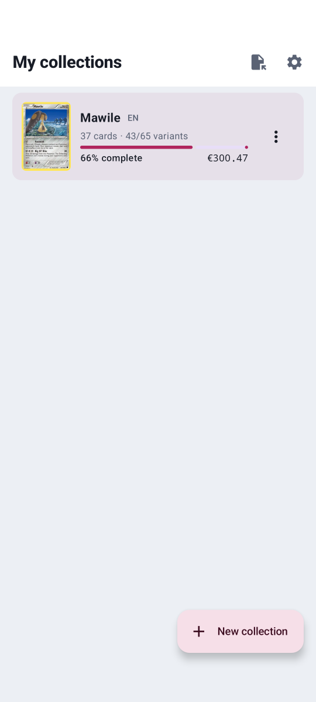
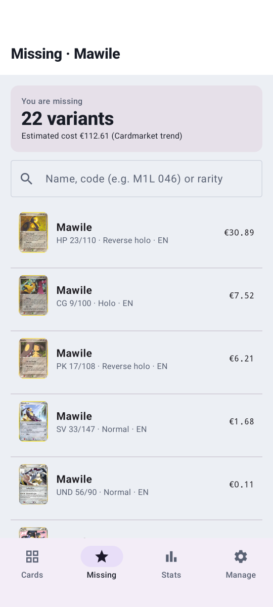
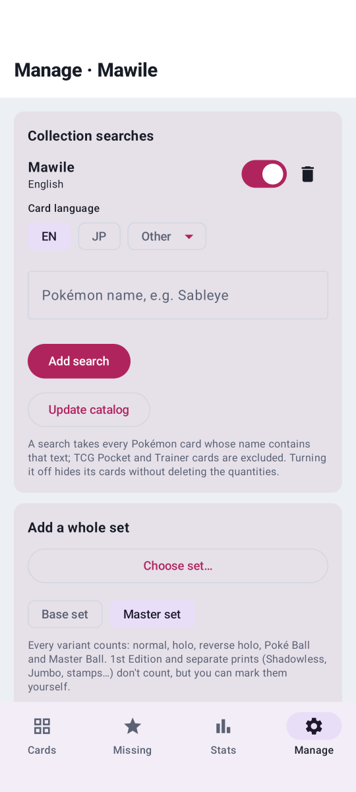
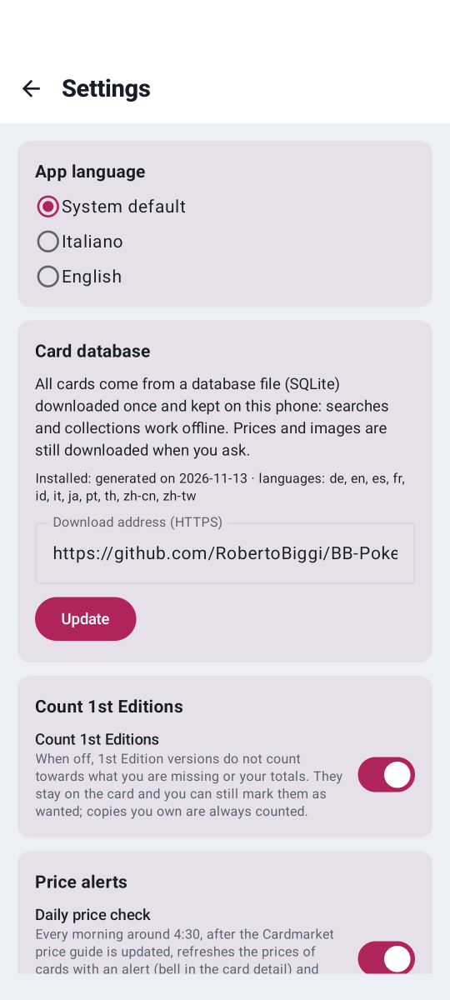

# Card Collection

An Android app to track your Pokémon card collection: which cards you own, in which variant and condition, which ones you are missing and what they are worth.

Cards and images are stored on your phone, so the app works offline. The network is only used to download images and prices, and only when you ask for it (or for price alerts, if you turn them on).

The app is available in English and Italian.

<p align="center">
  
  &nbsp;
  
  &nbsp;
  
</p>

## Highlights

- **Multiple collections**: by Pokémon (e.g. every Mawile), by set (base set or master set), or with hand-picked cards.
- **Every variant counts**: normal, holo, reverse holo, 1st Edition, Poké Ball, Master Ball… For each one you track copies and condition.
- **Prices**:
  - Cardmarket prices in euros;
  - CardTrader prices too, if you have an account;
  - prices you enter yourself.
- **Price alerts**: get a notification when a card goes up or down, or when it reaches the price you want.
- **Missing cards and statistics**: what you are missing, how much it costs to complete the collection, and what your cards are worth.
- **Backup to a file**: export a collection, with images if you like, and import it on another phone.
- **Cards in many languages**: English, Italian, French, German, Spanish, Portuguese, Japanese and more.

## Installation

The app is not on the Play Store. Install it from the APK published in this repository's [Releases](../../releases). It needs Android 8.0 or later.

**With automatic updates (recommended):**
1. Install [Obtainium](https://github.com/ImranR98/Obtainium).
2. Add this repository's address. Obtainium tells you about new versions and installs them.
3. While the repository is private, you also need a read-only GitHub token, set in the source settings in Obtainium.

**Manually:**
1. Download `card-collection-<version>.apk` from the latest Release.
2. Open it on your phone and allow installs from unknown sources.

The card database ships with the app: you can search and add cards right away, even offline.

## Getting started

1. Tap **New collection**, give it a name and type the Pokémon you want to follow (e.g. `Mawile`, or `Moltres, Zapdos`). The app finds every card of those Pokémon and downloads their images.
2. Tap **Prices** to download up-to-date prices.
3. Open a card and record the copies you own with **+** and **−**.

From then on everything stays on your phone. Tap **Prices** again whenever you want an update.

## Feature guide

### Your collections



The start screen lists all your collections, each with its cover, completion percentage and value. Tap one to open it.

From a collection's **⋮** menu you can:
- rename it and choose its card languages;
- export it to a JSON file;
- delete it.

The icon at the top **imports** a collection from a file.

Each collection has its own cards and quantities. Images and prices are shared, so nothing is downloaded twice.

<br clear="right">

### Cards


The grid shows every card in the collection. Each card has its image, its printed code and its price. The printed code is the one at the bottom left of the real card, e.g. `POR 032/088`.

- **Badges**: **`1/2`** is the number of variants you own out of those you want; **`×3`** is the total number of copies.
- **Search** by name, code (e.g. `M1L 046`) or rarity.
  - Names work in other languages too: "Omastar" also finds オムスター.
  - Accents and capital letters don't matter.
- **Filter** between all, owned and missing cards, and by language.
- **Sort** by release date, price, code or name.
- **Buttons at the top**: one updates the catalog (new cards and images), the other updates the prices. The work goes on even if you leave the app, with a progress notification.

<br clear="right">

### Card detail


Tap a card to see its large image and its details: set, series, rarity, language, release date and illustrator.

Below are the **variants**. For each one you can:
- record how many **copies** you own with **+** and **−**;
- set the **condition**: NM, LP, MP, HP or DMG;
- untick **"want it"** if you don't care about that variant, so it won't count as missing;
- see its **prices** by source, with date and trend;
- enter a **manual price** when no source has one.

At the top of the page you can:
- **update the price** of that card only;
- **download the image** again;
- **pick an image** from your gallery: handy for Japanese cards without an official picture. The picked image is resized and saved without metadata.

The links open the card on Cardmarket and TCGplayer, and on CardTrader if you enabled it.

<br clear="right">

### Price alerts


Under the prices of each variant there is a **Price alert** panel. Ask the app to notify you:

- **when the price goes up or down** by a percentage you choose for that card, from 1% to 50%;
- **when the price reaches an amount** you set, e.g. "tell me when it gets to €20". The alert fires when the lowest euro price is within 5% of that amount, or below it.

Turn on alerts once in **Settings → Price alerts**: they are off by default.

Every morning at about 4:30, after Cardmarket updates its price list, the app checks only the cards that have an alert. If something changed you get a notification; tap it to open the card.

<br clear="right">

### Missing cards



Lists every variant you want but don't own yet, with the **estimated cost** to complete the collection (Cardmarket trend prices). It also tells you how many cards don't have a price yet.

Variants marked as "not wanted" are not listed and don't count towards completion.

<br clear="right">

### Statistics


- **Completion**: variants you own out of those you want.
- **Copies**: the total, duplicates included.
- **Collection value**: euros and dollars are kept separate, with no currency conversion.
- **Progress** by language and by series.
- The **latest price updates**.

<br clear="right">

### Managing a collection



This is where you decide which cards belong to the collection.

- **Searches**: each search adds every card of one Pokémon in one language (e.g. `Mawile` in English, `クチート` in Japanese).
  - TCG Pocket cards and Trainers are left out.
  - You can turn a search off without losing your quantities.
- **Whole sets**: pick a set, vintage ones included, and collect it in one of two ways:
  - **base set**: one card per number;
  - **master set**: every variant (normal, holo, reverse, Poké Ball and Master Ball).
- **Single cards**: for promos or cards no search finds. Search by name or by the code printed on the card:
  - set code and number: `M3 117/080`, `DX 107`;
  - number only: `117/080`;
  - card id: `M3-117`, `ex8-107`.
- **Removed cards**: cards you removed stay here, and you can add them back at any time.
- **Export**: save the collection to a JSON file, with or without images.

<br clear="right">

### Settings



- **App language**: English, Italian, or the phone's language.
- **Card database**: shows the installed version and lets you update it.
- **Price sources**: choose which prices to show. Hidden prices don't appear on cards or in totals.
- **CardTrader** (optional): paste your API token (CardTrader → Settings → API). From then on every variant also shows the lowest CardTrader price.
  - The price is filtered by variant, language and condition: your condition or a better one.
  - Graded cards are excluded.
- **Price alerts**: turn on the daily check and pick the default threshold for new alerts.
- **1st Edition**: choose whether 1st Edition cards count as missing and in the totals.

<br clear="right">

### Backup and moving to a new phone

Each collection exports to a single JSON file with cards, quantities, conditions and prices. You choose whether to include images: none, small ones, or small and large ones.

On the other phone, import the file from the collection list, even without a network connection. Importing always creates a new collection and never touches the ones you already have. Backups from the first version of the app are accepted too.

## Privacy and security

- **No account and no server**: your data stays on your phone.
- **Cardmarket prices come from the official price list**: Cardmarket publishes it every night. The app downloads that file and never opens cardmarket.com, so there are no anti-bot blocks.
- **Few addresses contacted**: TCGdex images, the Cardmarket price list and, only if you turn it on, CardTrader. Nothing else.
- **Encrypted CardTrader token**: it is encrypted with an Android Keystore key that never leaves the phone. The token is left out of Android backups, so after a restore or on a new phone you need to enter it again.

## FAQ

**A card has no image.**
Open the card and tap "Download image". The app looks on TCGdex and then on CardTrader. If neither has one, pick an image from your gallery.

**A card has no price.**
Not every card is sold on Cardmarket; this is common with Japanese promos. Turn on CardTrader, or enter a manual price from the card detail.

**I don't get alerts.**
Check three things:
- the daily check is on in Settings;
- the app is allowed to send notifications in Android's settings;
- the card has a saved alert (the bell in its panel is filled in).

**Switching between a test build and a release.**
Test builds (the `card-collection-apk` artifact in Actions) are signed with a different key than releases, so Android won't install one over the other.
1. Export your collections first.
2. Uninstall the app.
3. Install the other build.
4. Import the collections again.

The same applies when upgrading from versions up to 0.5.0.

---

## For developers

| Module | Contents |
|---|---|
| `core/` | Pure Kotlin/JVM, no user-facing text. Includes: Cardmarket price list, CardTrader client, per-variant price mapping, source chain with rate limiter and circuit breaker, alert rules, validators, collection JSON format, statistics. |
| `app/` | Android. Includes: card database (SQLite bundled in the APK), Room, WorkManager, image store, Compose UI, import/export through the Storage Access Framework. Strings are in `res/values` (English) and `res/values-it` (Italian). |
| `docs/` | Architecture notes (`ARCHITECTURE.md`, in Italian) and README screenshots. |

```bash
./gradlew -PcoreOnly :core:test           # logic tests (JDK only)
./gradlew :app:testDebugUnitTest          # app tests (needs the Android SDK)
./gradlew :app:assembleDebug              # test APK
```

- **Card database**: `cards.sqlite` is built by a separate repository and published in the `catalog` release. CI downloads it and bundles it in the APK.
- **Releases**: every push to `main` publishes a Release whose APK is signed with the release key.
  - The version is `0.6.N`, where N grows with every commit.
  - Signing uses the secrets `RELEASE_KEYSTORE_BASE64`, `RELEASE_KEYSTORE_PASSWORD`, `RELEASE_KEY_ALIAS` and `RELEASE_KEY_PASSWORD`.
  - CI checks the certificate fingerprint before publishing.
  - Never commit the key: if it is lost, installed apps can no longer be updated.
- **README screenshots**: the `README screenshots` workflow (`.github/workflows/screenshots.yml`) starts an emulator and runs the `ReadmeScreenshots` test.
  - The test builds a Mawile collection with real data and saves the screens to `docs/screenshots`.
  - To refresh them, run the workflow manually from Actions.

## License

The code is released under the [MIT](LICENSE) license. Third-party data included or downloaded (TCGdex, PokeAPI, card images) remains subject to its own licenses and trademarks.

## Credits

- **Catalog and images**: [TCGdex](https://tcgdex.dev).
- **Prices**: [Cardmarket](https://www.cardmarket.com) (public price list) and [CardTrader](https://www.cardtrader.com).
- **Pokémon names in multiple languages**: [PokeAPI](https://pokeapi.co), BSD-3-Clause license.

Pokémon and Pokémon character names are trademarks of Nintendo, Creatures and GAME FREAK. This app is not affiliated with or endorsed by The Pokémon Company.
