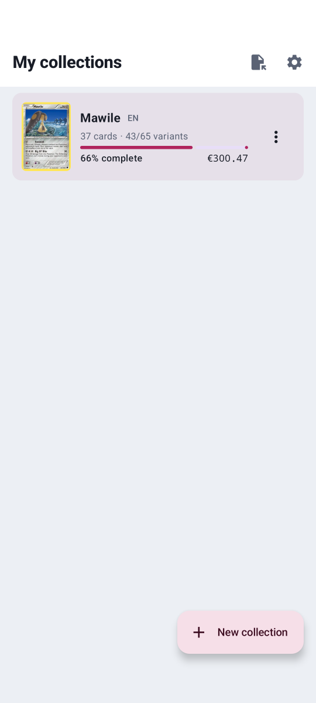
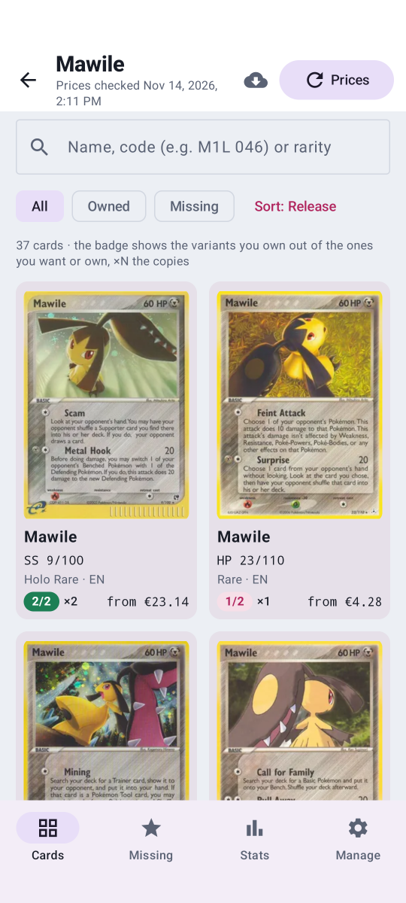
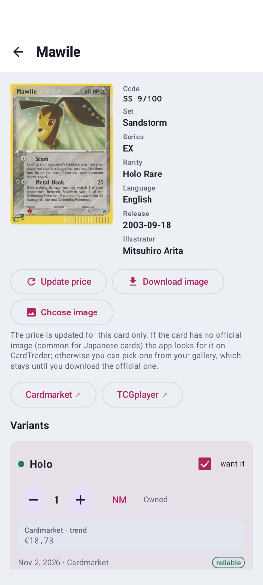
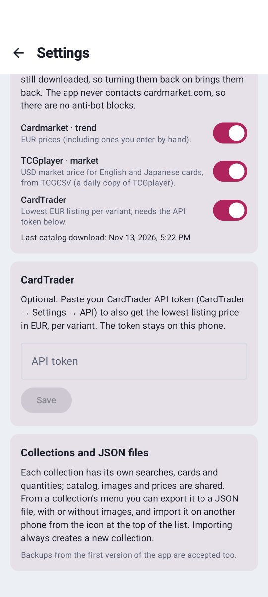
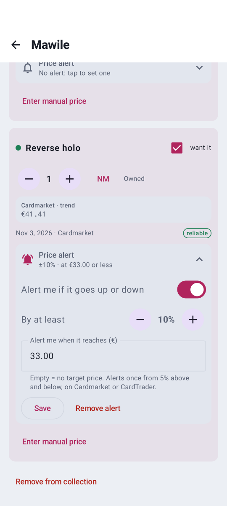
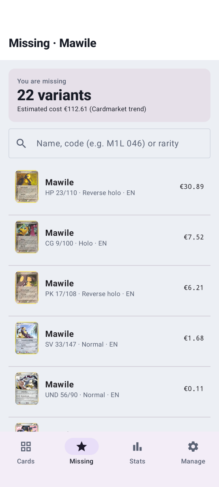
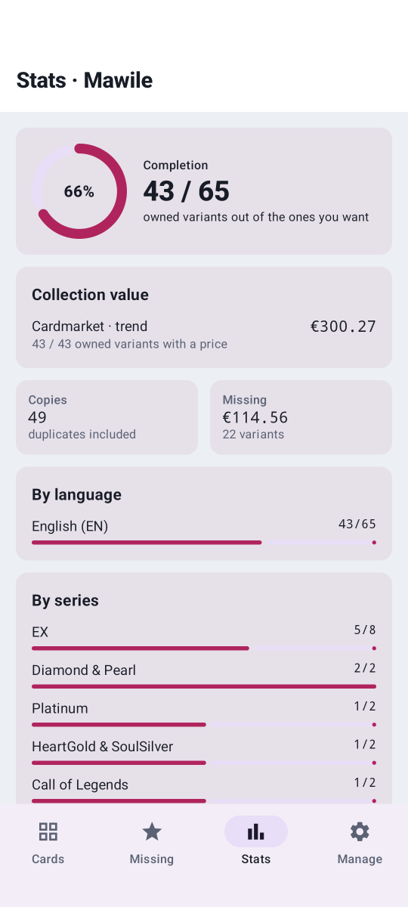
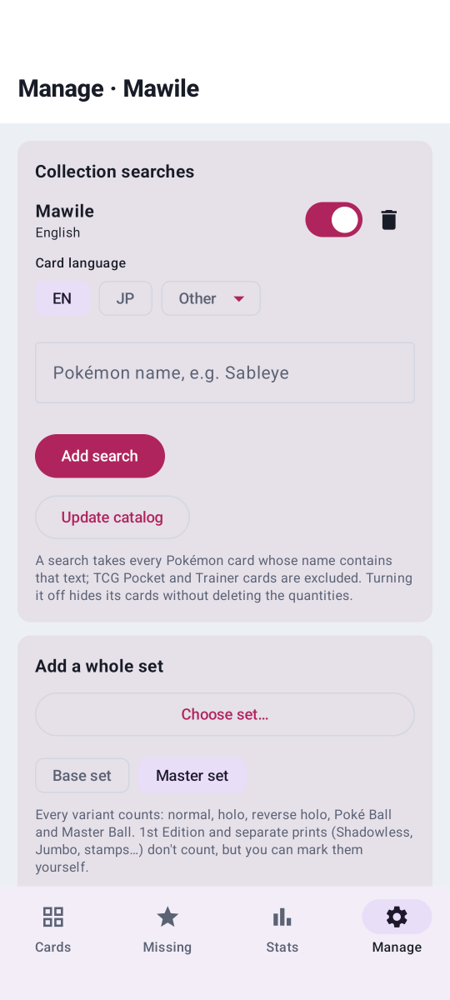
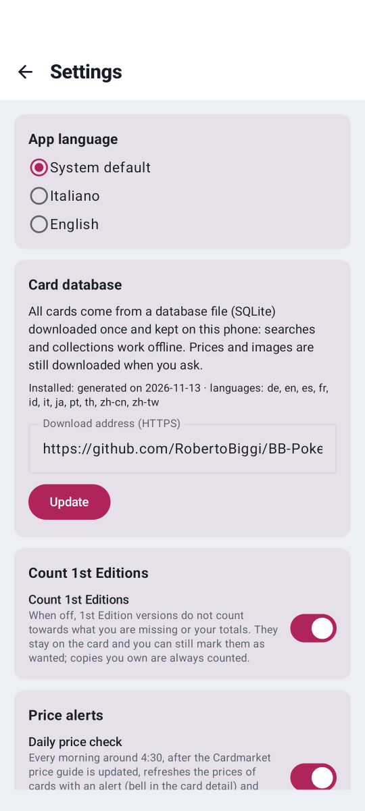

# BB PokeCollector: user guide

This guide covers every feature of the app, from installation to backups. The screenshots come from a real collection; prices change every day.

## Contents

1. [Installing and updating](#1-installing-and-updating)
2. [Your first collection](#2-your-first-collection)
3. [Collections](#3-collections)
4. [Browsing cards](#4-browsing-cards)
5. [Card detail and variants](#5-card-detail-and-variants)
6. [Prices](#6-prices)
7. [Price alerts](#7-price-alerts)
8. [Missing cards](#8-missing-cards)
9. [Statistics](#9-statistics)
10. [Managing a collection](#10-managing-a-collection)
11. [Settings](#11-settings)
12. [Backup and moving to a new phone](#12-backup-and-moving-to-a-new-phone)
13. [Privacy](#13-privacy)
14. [Troubleshooting](#14-troubleshooting)

---

## 1. Installing and updating

The app is not on the Play Store. It needs Android 8.0 or later.

**With automatic updates (recommended)**

1. Install [Obtainium](https://github.com/ImranR98/Obtainium).
2. Open the [README](../README.md#install) on your phone and tap **Get it on Obtainium**. The app is added with the right settings already filled in.
3. Confirm. Obtainium installs the app, checks for new versions in the background, notifies you and installs them with one tap.

If you prefer to add it by hand: tap **Add app** and paste `https://github.com/RobertoBiggi/BB-Pokecollector`.

A GitHub access token in Obtainium's settings is optional: it only avoids GitHub's limit on anonymous requests.

**Manually**

1. Tap **Download latest APK** in the [README](../README.md#install) (or download `bb-pokecollector.apk` from the latest Release).
2. Open the file on your phone.
3. If Android asks, allow installs from unknown sources.

To update, do the same again: the new version installs over the old one and keeps your collections.

On first launch the app downloads the card database by itself (about 35 MB), so keep an internet connection on. After that, searching and adding cards work offline. If the download fails, the app tries again the next time you open it, or you can start it from **Settings → Card database → Download**.

**After an app update.** When an update brings a newer card database, every collection shows **Needs update** on the home list. Each one updates by itself the first time you open it: the app reads its cards again from the database, from scratch, so cards that were added, removed or corrected there are applied. Your copies, conditions, notes, wanted slots, removed cards and the cards you added by hand are kept exactly as before. Images that were already downloaded stay unless the database now points to a different source for that card.

If a card is no longer in the database (removed, replaced by another one, or given a new id), it is not lost: it moves to a section at the end of the collection, under a divider, called **No longer in the card database**, with whatever copies and notes you had on it. Each one has a label that says why: **Replaced by …** when the same card is in the database with a new id (for example after two sets were merged), or **No longer in the card database** when it is simply gone. These cards do not count as missing. Long press to remove the ones you do not need, or leave them.

> **Coming from a test build.** Releases are signed with their own key. If you installed an older **Test build**, or an APK from the GitHub Actions runs of a development branch, Android won't install a release over it: export your collections (see [section 12](#12-backup-and-moving-to-a-new-phone)), uninstall the app, install the release and import them again. You only need to do this once.

## 2. Your first collection

1. Tap **New collection**.
2. Choose how to build it:
   - **By Pokémon**: give it a name and type the Pokémon you want to follow, one name (`Mawile`) or several separated by commas (`Moltres, Zapdos`);
   - **By set**: pick a whole set, as a base set or a master set (see [section 10](#10-managing-a-collection)).
3. Choose the card languages. English, Italian, French, German, Spanish, Portuguese and Japanese have full data; **Other** shows Chinese (Traditional and Simplified), Thai and Indonesian, which have few cards and almost no images or prices yet.
4. The app adds the cards and downloads the images. A progress bar and a notification show how it is going.
5. Tap **Prices** to download up-to-date prices.
6. Open a card and record the copies you own with **+** and **−**.

Everything is now on your phone. Come back to **Prices** whenever you want fresh prices.

## 3. Collections

The start screen lists your collections. Each one shows:

- its cover card;
- the card languages;
- how many cards and variants you own;
- the completion percentage;
- the total value.

Tap a collection to open it.

The **⋮** menu of a collection lets you:

- **rename it** and choose its card languages;
- **export it** to a JSON file (see [section 12](#12-backup-and-moving-to-a-new-phone));
- **delete it**: searches, quantities and added cards of that collection are removed. Images and prices stay for your other collections.

The icons at the top **import** a collection from a file and open the **settings**.

Collections are independent: each has its own cards, quantities and conditions. Images and prices are shared, so nothing is downloaded twice.

 

## 4. Browsing cards

The **Cards** tab shows the collection as a grid. Each card shows:

- its image;
- its **printed code**, the one at the bottom left of the real card (e.g. `SS 9/100`, `M1L 046/063`);
- its rarity and language;
- the lowest price of its variants.

**Badges**

- `2/2`: variants you own out of those you want or own. Green means complete.
- `×2`: total copies of the card, duplicates included.

**Search** matches names, codes and rarities.
- Try `M1L 046`, `117/080` or `holo`.
- Pokémon names work in any language: "Omastar" also finds オムスター.
- Accents, capital letters and punctuation are ignored, and hiragana matches katakana.

**Filter and sort**
- Filters: **All**, **Owned** and **Missing**, plus the card language when the collection has more than one.
- Sort order: release date, price, code or name.

**Buttons at the top**
- **Cloud**: updates the catalog. It adds new cards from your searches and downloads missing images.
- **Prices**: updates the prices of this collection.

Both jobs keep running if you leave the app, with a progress notification.

**Removing several cards**

1. **Long-press** a card to start a selection.
2. Tap more cards, or use **Select all**.
3. Remove them together.

Removed cards are not added back by later updates. You can restore them from **Manage → Removed cards**.

 

## 5. Card detail and variants

Tap a card to open its detail: the large image, then its code, set, series, rarity, language, release date and illustrator. Japanese sets also show their English name (**Set (EN)**), and promos without a number show the **Event** they were given out at, with its date.

**Card actions**

- **Update price**: refreshes the prices of this card only.
- **Download image**: tries the image sources one after another: TCGdex, Pokoin, CardTrader (if you set a token), Pokellector, Pokumon (promo cards, including the old unnumbered ones), Malie (localized prints of some sets and promos). The detail shows which source the image comes from.
- **Other prints**: when the card has other prints (the same card with a Staff or Winner stamp, for example), a line under the image says how many. Tap the image to see them, each with its name and prices; prints without a picture have a placeholder. The card's own image always stays the one shown.
- **Choose image**: pick a picture from your gallery, handy for cards that no source has. It is resized and saved without metadata, and stays until you download an official one.
- **Cardmarket / TCGplayer / CardTrader**: open the card on those websites.

**Variants**

Each variant (normal, holo, reverse holo, 1st Edition, Poké Ball, Master Ball…) is a *slot* of the collection. For each one you can:

- set the **copies** you own with **+** and **−**;
- set the **condition**: NM, LP, MP, HP or DMG. It also decides which CardTrader listings count (see [section 6](#6-prices));
- untick **want it** if you don't care about that variant: it won't count as missing or in the completion. Stamps and the extra Cardmarket products of a card start unticked, since a card can have many of them: tick the ones you collect;
- see its **prices**, with the date of the last update and a trend;
- **enter a manual price**, in euros, when no source has one;
- set a **price alert** (see [section 7](#7-price-alerts)).

At the bottom, **Remove from collection** hides the card. You can bring it back from **Manage → Removed cards**.

 

## 6. Prices

Prices are only downloaded when you ask for them: the **Prices** button, **Update price** on a card, or the daily alert check.

| Source | Currency | Notes |
|---|---|---|
| **Cardmarket** | EUR | Trend price from Cardmarket's official price list, refreshed every night. The app downloads the list and never opens cardmarket.com. |
| **CardTrader** | EUR | Optional, needs your API token (see [section 11](#11-settings)). Lowest listing per variant, filtered by language and condition. Graded cards are excluded. |
| **TCGplayer** | USD | Market price for English and Japanese cards, read from [TCGCSV](https://tcgcsv.com), a free daily copy of TCGplayer's data. Needs a card database that has the TCGplayer products; cards without one show no price. Only the normal, holo, reverse holo and 1st Edition prints have a price: separate prints such as shadowless or jumbo don't. |
| **Manual** | EUR | Entered by you from the card detail. |

Euros and dollars are never converted.

**CardTrader and conditions.** A listing counts if its condition is the one you set on the variant or a better one:

| Your condition | Listings that count |
|---|---|
| NM | Near Mint |
| LP | Slightly Played or better |
| MP | Moderately Played or better |
| HP | Played or better |
| DMG | any |

**Price labels**

- **reliable**: the price is for exactly that variant.
- **uncertain variant** / **indicative**: the source doesn't separate that variant, so the price is approximate.
- **old**: the price is more than 30 days old.

If a source rejects too many requests, the app waits and retries. After repeated blocks it pauses that source for a few hours; prices you already have stay valid.

 

## 7. Price alerts

A price alert sends you a notification when a card moves.

**1. Turn on the daily check (once)**

Go to **Settings → Price alerts** and turn on **Daily price check**. It is off by default. Allow notifications if Android asks.

**2. Set an alert on a variant**

Open a card, find the variant and tap **Price alert** under its prices. You can turn on one or both of these alerts:

- **Alert me if it goes up or down by at least N%.** Choose the percentage with **−** and **+**, from 1% to 50%. Each card can have its own value; new alerts start from the default set in Settings. It also watches the TCGplayer price in dollars.
- **Alert me when it reaches €X.** Type the price you would pay. The alert fires when the lowest euro price (Cardmarket or CardTrader) is within 5% of that amount, or below it.

Tap **Save**. The bell turns red and the panel shows a summary, e.g. "±10% · at €33.00 or less". **Remove alert** deletes it.

**How the check works**

- Every morning around 4:30, after Cardmarket publishes its new price list, the app updates only the cards that have an alert.
- Price changes are measured from the price of the last alert, so small daily moves add up. Each source is checked separately.
- The target-price alert fires once. It is armed again when the price goes back above the target.
- Tap a notification to open the card.
- **Check now** (in **Settings → Price alerts**) runs the same check right away. It is handy to try the notifications. A message tells you how many cards were checked and how many alerts were sent.

 

## 8. Missing cards

The **Missing** tab lists every variant you want but don't own yet, most expensive first.

At the top you see:
- how many variants are missing;
- the **estimated cost** to complete the collection, using Cardmarket trend prices;
- how many missing variants have no price yet.

Tap a row to open the card. Variants without "want it" are not listed.

 

## 9. Statistics

The **Stats** tab shows:

- **Completion**: variants you own out of those you want.
- **Collection value** per price source (Cardmarket, TCGplayer and, if enabled, CardTrader), with how many owned variants have a price. Euros and dollars stay separate and are never converted.
- **Copies** (duplicates included) and the **cost of the missing** cards.
- **Progress by language** and **by series**.
- The **latest price updates**, with how many prices were found.

 

## 10. Managing a collection

The **Manage** tab decides which cards belong to the collection.

**Searches**

- A search adds every Pokémon card whose name contains the text, in the chosen card language. For example, `Mawile` also finds "M Mawile-EX" and "Mega Mawile ex".
- TCG Pocket cards and Trainers are left out.
- The switch turns a search off: its cards are hidden, but your quantities are kept.
- The bin icon deletes the search.
- **Update catalog** applies the searches again, from scratch, and downloads missing images (it also starts by itself after an app update that changes the card database: see [section 1](#1-installing-and-updating)).

**Whole sets**

Tap **Choose set…** and search by name or set code (e.g. `ex8` or `DX`). The list covers every language at once; tap a language chip to show only that one, and tap it again to go back to all of them. Japanese sets also show their English name, and the list can be sorted by newest, oldest or name. Then pick how to collect the set:

- **Base set**: one slot per card, for its main version.
- **Master set**: every variant (normal, holo, reverse holo, Poké Ball and Master Ball). 1st Edition and special prints (Shadowless, Jumbo, stamps…) don't count, but you can tick "want it" on them.

**Single cards**

For promos or cards no search finds. Search by name or by the code printed on the card:

| You type | Example |
|---|---|
| Set code and number | `M3 117/080`, `DX 107` |
| Number only | `117/080` (extra words like the rarity are fine: `117/080 MUR`) |
| Card id | `M3-117`, `ex8-107` |

**Removed cards**: cards you removed from the grid or the detail. Tap **Restore** to bring one back.

**Export**: saves the collection to a file (see [section 12](#12-backup-and-moving-to-a-new-phone)).

 

## 11. Settings

Open Settings from the gear icon on the start screen.

- **App language**: system default, Italian or English.
- **Card database**: shows when the installed database was built and which card languages it has. **Update** downloads a newer one.
- **Count 1st Editions**: when off, 1st Edition variants don't count as missing or in the totals. Copies you own are always counted.
- **Price alerts**: the daily check (see [section 7](#7-price-alerts)), the default threshold for new alerts, and **Check now** to run the check right away. A warning appears if Android blocks the app's notifications.
- **Price sources**: choose which prices to show. Hidden prices disappear from cards, grids and totals, but Cardmarket and CardTrader prices are still downloaded, so turning them back on restores them. TCGplayer prices are only downloaded while they are shown.
- **CardTrader**: paste your API token, found on CardTrader under *Settings → API*. From then on, price updates also fetch CardTrader prices, and CardTrader becomes an image source.
- **Anonymous statistics**: once a day the app tells [Aptabase](https://aptabase.com) that it was opened (see [section 13](#13-privacy)). Turn it off and nothing is sent.

 

## 12. Backup and moving to a new phone

**Export**

1. Use the **⋮** menu of a collection on the start screen, or **Manage → Export**.
2. Choose how to handle images:
   - **Without images**: a light file; images are downloaded again later.
   - **With small images**: the collection can be browsed offline right away.
   - **With small and large images**: the heaviest file.
3. Choose where to save the file: phone storage, Google Drive, and so on.

The file contains cards, quantities, conditions, "want it" choices and prices.

**Import**

1. Tap the import icon at the top of the start screen.
2. Pick the file. No network is needed.
3. The import always creates a **new** collection and never changes the ones you have.

Backups from the first version of the app are accepted too.

> The CardTrader token is not included in backups. Re-enter it in Settings on the new phone.

## 13. Privacy

- **No account and no server**: your collections stay on your phone.
- **Only the addresses it needs**: the app contacts only the image sources, Cardmarket's price-list file, TCGCSV (TCGplayer prices), the card database download, the anonymous counter below and, if you set a token, the CardTrader API. Every other address is blocked.
- **CardTrader token**: encrypted with an Android Keystore key that never leaves the phone, and excluded from Android backups.
- **Images you choose**: re-encoded without metadata, so location and camera details are not kept.
- **Anonymous statistics**: once a day the app sends one `app_open` event to [Aptabase](https://aptabase.com) with the app version, the Android version and the language. No device identifier, nothing about your collection. It is on by default; turn it off in **Settings → Anonymous statistics** and nothing is sent.

## 14. Troubleshooting

**A card has no image.**
Open it and tap **Download image**: the app tries every source. Setting a CardTrader token adds one more source. If none has the image, use **Choose image**.

**A card has no price.**
Not every card is sold on Cardmarket; this is common for Japanese promos. Set a CardTrader token, or enter a manual price.

**I don't get price alerts.** Check that:
- **Daily price check** is on in Settings;
- Android allows the app's notifications;
- the card has a saved alert (red bell in its panel);
- the price really moved by the chosen percentage since the last alert.

Tap **Check now** in Settings to run the check right away. The message tells you how many cards were checked and how many alerts were sent.

**Prices or images don't download.**
Check your connection. Cards and prices you already have stay available offline. Jobs started while offline wait for the connection.

**The app says the card database is missing.**
Go to **Settings → Card database** and tap **Update**.

**Obtainium can't install an update ("signature" or "conflict" error).**
The installed app is an old test build, signed with a different key: see the note at the end of [section 1](#1-installing-and-updating).
